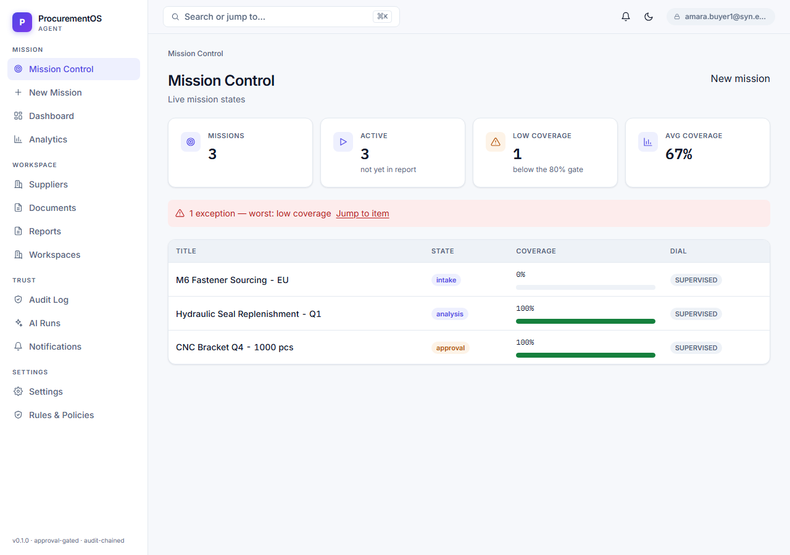
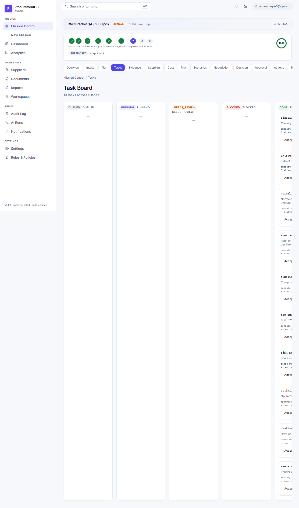

# ProcurementOS-Agent

An autonomous procurement mission agent. It takes a sourcing request from
intake through plan, evidence, analysis, scenarios and negotiation, and stops
at every gate that needs a human — award, money, contracts, external messages.

Deterministic math is the source of truth; AI explains and drafts, never
decides. Every material number traces back to an evidence span or a reasoned
waiver.

```
intake → plan → evidence → analysis → scenarios → negotiation → approval → action → report
```

## What it does

- **Ingests quotes and contracts** from PDF, text and spreadsheets, extracts the
  required fields, and quarantines anything carrying a prompt-injection payload
  or a macro.
- **Runs a deterministic engine** — sourcing comparison, supplier intelligence,
  total cost of ownership with FX, risk scoring, and scenario optimisation.
  Same input, same numbers, every time; golden vectors pin it.
- **Runs the mission as a state machine.** A mission can only advance when its
  gate's preconditions hold: evidence coverage above the threshold, no
  unresolved conflicts, a brief that cites its lines, a negotiation draft inside
  policy.
- **Puts a human in the loop** where it matters. Awards, money, contracts and
  outbound messages require an explicit approval from the right lane; the
  award value is computed server-side from certified results, so a client
  cannot talk the server into a cheaper winner.
- **Keeps a hash-chained audit trail.** Every action is appended to a chain
  that can be re-walked and verified end to end.
- **Ships a web app** covering the whole mission, plus an HTTP API, an async
  worker, and operational drills for backup, restore, rollback and egress.

## Screens

| | |
|---|---|
|  |  |
| Mission Control | Analysis |

More in [`docs/screenshots/`](docs/screenshots). A guided walk through every
screen is in [`docs/WALKTHROUGH.md`](docs/WALKTHROUGH.md).

## Quick start

One command seeds the synthetic tenant, builds three demo missions through the
real HTTP endpoints, starts the API and the web app, and prints the
credentials:

```powershell
python scripts/demo.py
```

| | |
|---|---|
| Web app | http://localhost:3000 |
| API | http://localhost:8000/api/v1 (OpenAPI at `/docs`) |

Requires Python 3.12+ and Node 20+. The demo uses SQLite and needs no other
service. To run it by hand:

```powershell
pip install -r requirements.lock
pip install -e ".[dev]"
npm ci --prefix web
python seed/seed_pos.py --tenant SYN-TENANT-01 --db-url "sqlite+aiosqlite:///./pos_dev.db"
python seed/make_demo_mission.py --db-url "sqlite+aiosqlite:///./pos_dev.db"
$env:DATABASE_URL = "sqlite+aiosqlite:///./pos_dev.db"
python -m uvicorn app.main:app --port 8000
npm run start --prefix web
```

### Signing in

There is one credential: an email and a password. Signing in exchanges them for
a session token that is random, stored hashed, expiry-bound and revocable.

```
daniel.manager@syn.example      ProcurementManager
amara.buyer1@syn.example        Buyer
fatima.finance@syn.example      FinanceReviewer
chen.compliance@syn.example     ComplianceReviewer
admin.seed@syn.example           Admin
```

Every seeded persona shares the demo password `syn-Demo-2026!`. It is
synthetic, it authenticates nothing outside the local demo database, and the
seed refuses to run against a non-synthetic database.

In production, set `OIDC_ISSUER` and `OIDC_AUDIENCE` and the app authenticates
through the identity provider instead. The app refuses to boot in production
without them.

## Stack

| Layer | |
|---|---|
| API | FastAPI, SQLAlchemy 2 (async), Alembic |
| Data | Postgres in production, SQLite locally |
| Engine | pure Python — deterministic sourcing, cost, risk, scenarios |
| Queue | Redis + RQ, with an in-process fallback when no broker is reachable |
| Web | Next.js 16 (App Router), React 19, TypeScript, Tailwind 4 |
| Storage | S3-compatible object storage |

Money is always integer minor units. Timestamps are real columns.

## Repository layout

```text
/app/        FastAPI: missions, plans, tasks, ingest, evidence, engine glue,
             negotiation, approvals, actions, tools, AI, reports, audit, auth
/engine/     the deterministic math: sourcing, supplier, cost, risk, scenarios
/worker/     queue dispatch, retries, poison quarantine, in-process plan execution
/web/        the Next.js app: mission screens and the component library
/alembic/    migrations
/seed/       synthetic data and the regenerable fixture corpus
/scripts/    operational tools: demo, backup/restore, rollback, egress drill,
             env checks, lockfile
/tests/      the test suite, including the golden vector suites
/docs/       runbook, API contract, ADRs, evaluation design, walkthrough
```

## Security model

- **Nothing material moves without a human.** Awarding, spending, contracting
  and sending an external message all require an approval from the right
  lane, and the quorum is checked server-side.
- **The server computes the money.** Award values come from certified
  analysis results, never from the client payload.
- **Quarantine before extraction.** Uploads are scanned for injection payloads
  and macros before anything is parsed; a flagged document never reaches a
  planner.
- **Tenant isolation is enforced in the query**, not in the UI.
- **Outbound calls go through one egress policy** — scheme allowlist, host
  allowlist, redirects not followed.
- **The audit trail is hash-chained** and verifiable with a single request.
- **AI output is untrusted** and is scanned for hallucinated evidence before
  it can be shown as a brief.

## Development

```powershell
ruff check app worker engine seed tests alembic scripts
ruff format --check app worker engine seed tests alembic scripts
mypy app worker engine seed scripts
pytest -q -m "not integration"
npm run lint --prefix web
npm run typecheck --prefix web
npm run build --prefix web
npm run test --prefix web
```

The Postgres-backed tests need a running server and are marked `integration`:

```powershell
pytest -q -m integration
```

CI runs the fast gate chain on every push and pull request, and the heavy legs
(Postgres, container builds, the end-to-end walk) weekly and on demand.

## Configuration

Everything is configured through the environment; see [`.env.example`](.env.example)
for the full list and [`deploy/env/`](deploy/env) for per-environment templates.

| Variable | |
|---|---|
| `DATABASE_URL` | async database URL (asyncpg / aiosqlite) |
| `DATABASE_SYNC_URL` | sync URL Alembic uses (psycopg) |
| `OIDC_ISSUER`, `OIDC_AUDIENCE` | the identity provider; required in production |
| `REDIS_URL` | the queue; optional, tasks run in-process without it |
| `S3_*`, `AWS_*` | object storage |
| `AI_PRIMARY_*`, `AI_FALLBACK_*` | the AI provider and its fallback; empty means deterministic notes only |
| `OUTBOX_WEBHOOK_URL` | where approved messages are delivered; empty means they stay queued |

## Documentation

| | |
|---|---|
| [`docs/RUNBOOK.md`](docs/RUNBOOK.md) | running it, operating it, the drills |
| [`docs/API_CONTRACT.md`](docs/API_CONTRACT.md) | the endpoint inventory |
| [`docs/WALKTHROUGH.md`](docs/WALKTHROUGH.md) | a guided pass over the product |
| [`docs/EVALUATION.md`](docs/EVALUATION.md) | how the engine is evaluated |
| [`docs/RELEASE_GATE.md`](docs/RELEASE_GATE.md) | the release checklist |
| [`docs/adr/`](docs/adr) | the decisions behind the code |

## License

Apache 2.0 — see [LICENSE](LICENSE).

Contributions are welcome; see [CONTRIBUTING.md](CONTRIBUTING.md). Security
issues: see [SECURITY.md](SECURITY.md).

All data in this repository is synthetic. It describes no real supplier, no
real quote, and no real person.
